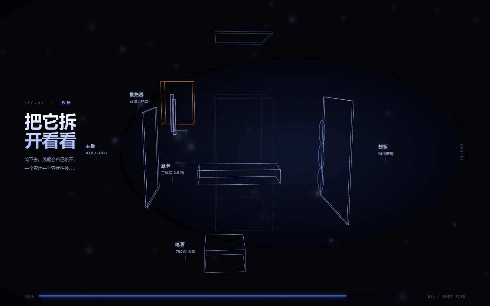

# 前端与动效 · 一个人做高端网页与代码渲染视频的工作台

这是一份**真实在用的个人工作台**，不是教学仓库：一个非软件工程背景、用 AI 结对的人，做「有动效的高端营销页 + Three.js 场景 + 由代码逐帧渲染出的视频」时，实际沉淀下来的目录契约、验收门槛、踩坑记录与三个可跑的样张。

所有内容都是边做边改的。文件夹里还留着失败稿和待办，这是它作为工作台的证据。

## 为什么网页和视频放在同一个仓库

这里的「视频」不是模型生成的像素，而是**代码按 `render(t)` 逐帧画出画面 → 无头浏览器截帧 → ffmpeg 合成 mp4**。

所以网页与视频同栈：共用同一份设计变量（`packages/tokens`）、同一张缓动与时长表（`packages/motion`）、同一套确定性纪律。这也是它们能待在同一个仓库的唯一硬理由——除此之外，两类产物没有任何耦合。

## 目录

```
AGENTS.md          工作区规范：五种运行模态、目录契约、六条红线、验收口径
ROUTER.md          意图路由表：按「用户说了什么」决定读哪一份文档，避免一上来通读全库
docs/              动效规范 · 渲染管线 · 验收标准
packages/          tokens（设计变量唯一真源）· motion（缓动与时长表，网页与视频共用）
recipes/           工艺手册：方法论与失败模式表，读完照着做，本身不是资产
motions/           动效资产条目：library.json + schema + 模板 + 单条目目录
apps/              在制网页
video/             在制片子
out/               产物（不入库）
```

判据一句话：**方法**进 `recipes/`（换个项目也成立），**条目**进 `motions/<slug>/`（一个具体效果、能被引用），**作品**进 `apps/` 或 `video/`（这一页、这一支）。

## 三个可跑的样张（`apps/recruit-explore/`）

三个方向都是在同一天里做出来的**方向验证稿**，用来回答「视觉语言对不对、拆解节奏舒不舒服」。它们的共同点是：整页只由一个滚动进度 `p ∈ [0, 1]` 驱动，所以下滚拆开、上滚收回是同一个机制自然得到的，不需要另写反播。

| 文件 | 方向 | 强项 | 弱项 |
|---|---|---|---|
| `s1c-dark-wire.html` | 暗场线框 | 科技感最直给，零资产、体积最小，移动端压力最小 | 线框没有材质就没有物件感，看久了像 CAD 预览 |
| `s2d-blueprint-dark.html` | 暗底蓝图图纸 | 信息承载最强，零件标注与参数都能挂上去 | 不震撼——是「设计资料」而非「视觉奇观」 |
| `s3-product.html` | 产品影像 | 最像正经产品官网，有重量与纵深 | 程序化几何的上限就是「器材感」，到不了真机广告 |



**必须走静态服务器，不能双击打开**：样张用 ES module 加载本地 `vendor/three.*.js`，`file://` 会被 CORS 拦掉。

```sh
node apps/recruit-explore/serve.mjs 8781
# 然后访问 http://127.0.0.1:8781/s1c-dark-wire.html
```

页面都支持 `?t=0.8` 锁住滚动进度，方便截图与逐帧录制；`?dbg=1` 会显示 draw call / 三角形数等诊断行。

`vendor/` 里放的是 three.js 的**两个**文件（`three.module.js` + `three.core.js`）。只拷前一个会 `Failed to resolve module specifier "./three.core.js"`——这是新版 three 把核心拆出去造成的，已踩过。

## 工艺笔记

| 文件 | 内容 |
|---|---|
| `recipes/scroll-teardown-headless.md` | 滚动拆解页 + 无头截图的**静默坑**：sticky 舞台被滚动占位顶出视口、WebGL 只渲染一次时截图拿空白画布、正反斜杠不一致导致静态服务 403、pnpm 装 ffmpeg 的四个连环坑 |
| `recipes/scroll-teardown-design.md` | 同题材的**视觉与相机坑**：按包围盒实时取景导致「镜头来回」、缺 IBL 导致材质发闷、多 ScrollTrigger 导致跳幕、SplitText 切中文爆版、标注互叠、程序化几何的视觉天花板 |
| `recipes/asset-audit-playbook.md` | 一次性盘点上百个第三方素材包时的五档判据、防漏筛方法与五个隐蔽陷阱（含 `prefers-reduced-motion` 与 `font-weight` 过渡在逐帧渲染里的不确定性） |
| `recipes/_TEMPLATE.md` | 六件套模板 |

## 一个完整案例：`apps/recruit-site/`

`STORYBOARD.md`（分幕脚本）+ `PLAN.md`（任务树、关键路径、选型反方论证）是一个真实招新站的定稿级设计文档。读出它比读代码快：

- 七幕叙事、700vh 行程、全站只有一个渲染器和一个进度变量；
- 相机 7 个关键帧**预烘焙成表**，`render(p)` 只做插值，禁止实时按包围盒重算；
- 12 件零件的错时表（方向向量 × 位移量）、材质随进度插值的曲线；
- 11 条验收，包括「贴脸镜头不穿模」「缩到 320px 仍认得出是机箱」这类容易被漏掉的项。

案例里的社团、学校、年份均已泛化为「示例社团 / DEMO CLUB」。

## 六条红线

1. **确定性**：`render(t)` 内禁止墙钟时间、无种子随机、CSS 动画与过渡、rAF 驱动、依赖上一帧的状态累加。
2. **模拟类效果**（弹簧、粒子、逐帧积分）必须在 `setup()` 里按固定步长预算成表，`render(t)` 只查表。
3. **素材全本地**：禁止远程字体、CDN 脚本、远程图片。（这条最常被「最佳实践模板」违反，见 `asset-audit-playbook.md`）
4. **参考素材不进仓库**：参考视频与截图只留本地，仓库里只存测出来的时间与几何元数据。
5. **第三方代码一律独立重写**，不拷贝源码；来源记在 `SOURCE.md`。
6. **渲染是独占 CPU 的重任务**，必须跑后台 job，绝不塞进 `dev` 脚本。

## 已知未完成（诚实标注）

- `docs/渲染管线.md` 描述的是 [Multiplane](https://github.com/LBEILC/Multiplane)（Apache-2.0）这条路线，**本机尚未安装**，其中命令与退出码按上游文档整理，未逐一实测；实际跑通的是 `recipes/scroll-teardown-headless.md` 里那条「无头 Edge + ffmpeg」的手工链路。
- `motions/` 目前只有模板与 schema，没有已入库条目。
- `ROUTER.md` 里提到的 `recipes/motion-atoms.md` 等几篇尚未落盘，表中已标注。
- 移动端只在设计上做了规划（竖放机箱、点选弹卡、玻璃改不透明板），样张未做移动端适配。

## 许可

- **代码**（`apps/` 下的 HTML/JS/PS1/MJS、`packages/` 的 JSON 等）：[MIT](LICENSE)
- **文档与工艺笔记**（`*.md`）：[CC BY 4.0](LICENSE-DOCS)

`apps/recruit-explore/vendor/` 里的 three.js 为 MIT 许可，版权归 three.js 作者所有。
